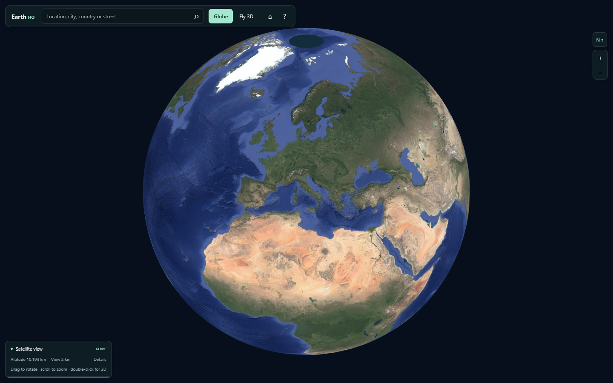
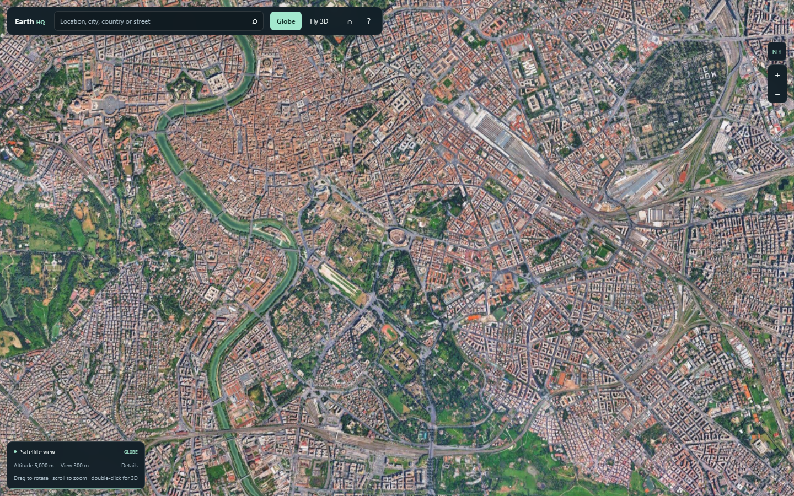
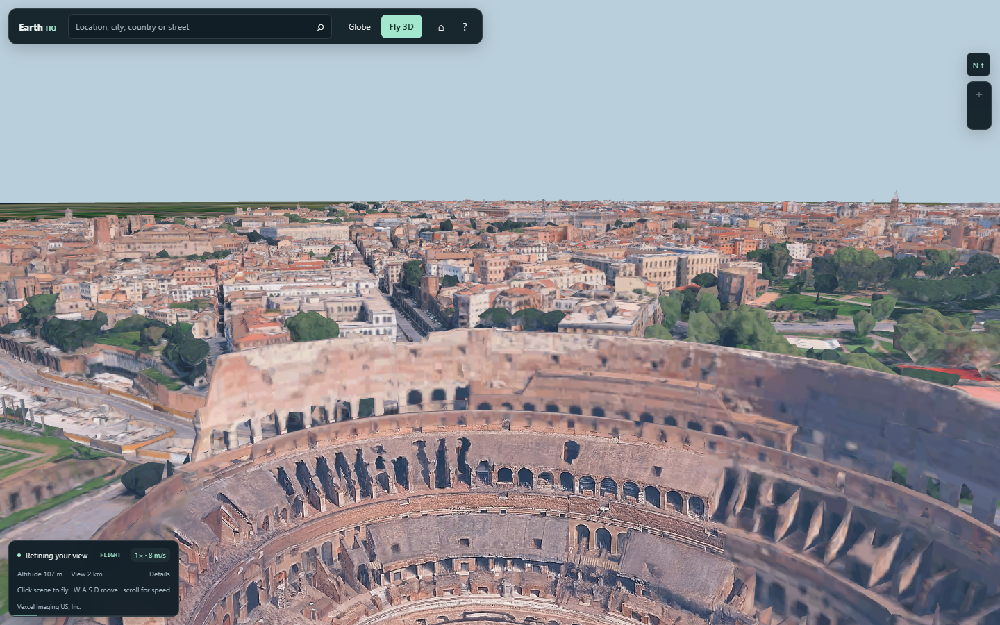

# Tiles 3D High Res

A JavaScript streaming engine and browser viewer for satellite imagery and detailed photogrammetric terrain. One bundle contains both the 2D satellite layer and the 3D tile engine, using the same provider. The viewer opens as a globe; selecting **Fly 3D** starts flight above the selected location and loads nearby geometry automatically.

There is no download button. Images refine as you zoom, and 3D terrain streams as you fly. The default 3D viewing distance is **2 km**.

## Preview

### Satellite globe



### Detailed satellite view



### Flight and progressive 3D streaming



These are screenshots of the actual viewer. The flight image shows progressive loading, including parent previews; it does not imply that the entire 2 km area has finished loading at terminal resolution. Imagery and geometry retain their providers' copyrights. The viewer interface is in English.

## Build and run

Use Node.js **24.22.1** (`.nvmrc`) and npm **11.10.1** (`packageManager`). No API key is included or required by the currently configured endpoints.

```sh
git clone https://github.com/Artur73737/tiles-3D-high-res.git
cd tiles-3D-high-res
npm ci
npm run build
```

Open the generated `globo-hq.html` in a current desktop Chrome browser. The page contains its JavaScript and styles, so a separate application server is unnecessary. An internet connection is required for map data. For embedding or consistent persistent-cache behavior, serve the files from a stable localhost or HTTPS origin.

The build creates:

| Artifact | Purpose |
| --- | --- |
| `globo-hq.html` | Self-contained viewer with globe navigation, flight, walking, collision detection and UI |
| `dist/earth-hq.bundle.js` | One IIFE script exposing `window.EarthHQ`, including Three.js, the satellite layer and the 3D decoder/streamer |
| `dist/earth-hq.esm.js` | One ES module containing both layers; imports `three` from the host application |

Generated artifacts, dependencies, local caches and downloaded fixtures are excluded from Git. Rebuild after changing source files. `examples/integration.html` demonstrates the single-script integration after building.

## Using the viewer

The globe uses satellite tiles. Drag to rotate with direct 1:1 surface tracking: the grabbed point stays under the pointer, with no acceleration or inertia after release. Use the wheel or the plus/minus buttons to zoom, or search for a location, city, country or street. Press Enter or the search icon, then select a result to centre the satellite globe. Country and city results use a wider view than street addresses. **Fly 3D** enters flight over the point at the centre of the globe view. Double-clicking a point on the globe enters 3D there. The home button returns to the Rome demonstration in 3D.

In 3D, click the scene to capture the mouse. Escape releases it. The compact top bar holds place search, view modes and the command guide. Streaming details expand inside the bottom status card. On smaller screens the search moves to a second row; status and navigation controls occupy separate areas. Flight currently requires a keyboard and mouse; touch movement controls are not implemented.

| Input | Action |
| --- | --- |
| Mouse | Look around while the pointer is captured |
| W / A / S / D | Move forward / left / backward / right |
| Double-tap W, holding the second press | Move three times faster until W is released |
| Wheel forward / backward in flight | Increase / decrease flight speed, from the default 1x up to 16x |
| Click the speed indicator | Reset flight speed to 1x |
| Space in flight | Ascend |
| Shift in flight | Descend |
| Double-tap Space | Toggle flight and walking |
| Space while walking | Jump |
| G | Return to the satellite globe |
| R | Reset to the local ground spawn |
| Escape | Release the pointer |

Flight starts at 8 m/s horizontally. Each wheel step changes the speed multiplier by 25%; scrolling backward stops at the default. The multiplier also applies to ascent/descent and combines with sprint. Collision steps scale with travel distance at higher speeds. In globe mode the wheel still zooms.

Place search uses the [Photon public geocoder](https://github.com/komoot/photon/blob/master/docs/api-v1.md), with OpenStreetMap data. Queries are sent only on submission, not on every keystroke. Search requests time out after 12 seconds; replacing the query or dismissing results cancels the old request. The geocoder is separate from tile delivery: both imagery layers still use the same tile provider. The public search service has no availability guarantee.

The initial flight position is 80 m above a verified local ground surface. Walking and flight collide with the available photogrammetric triangles. Movement waits for local terrain/colliders to be ready. Gaps and inaccuracies in the provider's geometry can affect collisions.

Optional URL parameters:

```text
globo-hq.html?view=3d                     Start directly in flight
globo-hq.html?view=3d&visibility=3000     Request a 3 km 3D viewing distance
globo-hq.html?view=3d&visibility=300      Use a smaller area for constrained hardware
globo-hq.html?view=3d&hqAltitude=1800    Activate automatic HQ streaming below 1.8 km
```

`radius` is also accepted as a compatibility alias for `visibility`. The default is 2,000 m. Higher distances increase network, CPU and GPU requirements substantially.

## How the bundle works

### Satellite imagery

`SatelliteLayer` selects Web Mercator raster tiles for the visible part of the globe. It requests more detailed tiles as their projected texels become larger than the screen target. Parent tiles remain visible while children load or when detailed imagery is unavailable. The selection uses the drawing-buffer resolution, not a single stretched overview texture.

The default maximum request zoom is **22**, configurable through `maxZoom`. The layer requests the detail needed at the current view scale, up to that ceiling. Native image resolution varies by location; requesting a higher zoom cannot create detail absent from the source. Satellite coverage ends at approximately +/-85.05 degrees latitude, the Web Mercator limit; polar caps use the base sphere color.

Requests, decoded image ownership, view selection and LRU eviction are managed by the satellite layer inside the bundle. The demo HTML does not implement a second map provider. The layer retains up to 512 raster tiles by default and uses eight concurrent requests, mipmaps and anisotropic filtering.

### Maximum-detail 3D terrain

`EarthHQStreaming` reads the Rocktree hierarchy and follows every selected branch to its declared terminal nodes. It does not stop at a hard-coded 3D level or substitute a reduced texture for the final payload. Terrain, buildings and additional layers present in the decoded payload are retained. This is a Rocktree client, not an OGC 3D Tiles implementation.

The active demand follows the surface position and horizontal viewing direction. Scheduling uses the camera's actual 3D gaze, including pitch: the central view receives first priority, then the rest of the view, nearby ground, and surrounding previews. Turning or pitching the camera reprioritizes pending payloads. Already active requests finish within the concurrency limit.

After selecting surrounding previews, the engine discovers and publishes the first gaze-facing parent footprint immediately, then the nearby collision area, then the remaining selected footprints in small batches. Distant metadata no longer gates all visible HQ payloads. Each footprint is examined completely so its coarse parent can retire as soon as its terminal meshes arrive. Final demand may conservatively include edge descendants beyond the nominal sector. Previously examined local collision coverage remains usable during subsequent gaze changes. Initial ground preparation is still required before entering flight, and camera priority starts once the viewer supplies its camera through `update()`.

Payload requests receive priority in bounded bursts, allowing metadata and surrounding previews to keep making progress. Metadata traversal bounds active branches by the configured concurrency and discards the obsolete traversal frontier when the view changes. Queued payload priorities are computed once per sort rather than recomputing vector geometry for every comparator call.

Turning the camera updates demand without discarding already resident geometry inside the retention radius. Completed parent previews are hidden and retained for reuse; they are released under memory pressure or when outside the retained area. This avoids blanking the landscape merely because the camera turned. Retention is bounded, so travel, expiration, capacity pressure or a provider epoch change can still require another download.

Automatic 3D requests start below **2,500 m**, pause above **3,000 m**, and resume on descent. The 500 m hysteresis avoids repeated restarts around the threshold. In the viewer, the globe mode explicitly pauses 3D loading; selecting 3D enters flight and enables automatic streaming. The satellite layer continues independently.

`previewRadiusMeters: 120` in the viewer sets the near-field node-bound target for parent previews. The allowed preview size grows with distance to provide a distant panorama without downloading thousands of equally fine previews first. This only changes temporary preview selection; final 3D demand still follows every selected branch to its terminal detail. It is not the viewing distance. Nearby parent footprints are examined in full, including descendants outside the current heading, and retired independently of the distant search. The periodic freshness check waits for current work to settle instead of repeatedly canceling unfinished discovery. Parent previews never count as completed maximum-detail leaves and are not used for collision detection.

### Coverage is explicit

`getCoverage().complete` is true only when discovery has resolved all selected branches and all required terminal leaves are loaded. An idle request queue, a visible preview, or a resolved `requestRegion()` promise does not by itself establish complete coverage.

HTTP failures, unknown metadata and insufficient GPU capacity remain visible as incomplete coverage. Explicitly empty nodes are distinguished from missing data. The complete flag describes the examined provider hierarchy, not the absence of holes in the original photogrammetry.

A 2 km area around Rome can require more than 150,000 terminal tiles. The viewer offers progressive visibility at that distance; it does not promise instant maximum detail across the entire area or unlimited GPU memory.

## Single-script integration

Use the exported `THREE` instance with the standalone bundle:

```html
<script src="dist/earth-hq.bundle.js"></script>
<script>
const { THREE, EarthHQStreaming, SatelliteLayer, geoToECEF } = EarthHQ;
const renderer = new THREE.WebGLRenderer({
  antialias: true,
  logarithmicDepthBuffer: true
});
renderer.setSize(innerWidth, innerHeight);
document.body.appendChild(renderer.domElement);

const scene = new THREE.Scene();
const camera = new THREE.PerspectiveCamera(55, innerWidth / innerHeight, 0.1, 1e8);
const focus = geoToECEF(41.88931, 12.49223);
camera.position.copy(geoToECEF(41.88931, 12.49223,150));
camera.up.set(0,0,1);
camera.lookAt(focus);

const satellite = new SatelliteLayer({ renderer });
const terrain = new EarthHQStreaming({
  renderer,
  radiusMeters: 100,
  retainRadiusMeters: 200,
  previewRadiusMeters: 120
});
scene.add(satellite.group, terrain.group);

terrain.start().then(() => {
  renderer.setAnimationLoop(() => {
    satellite.update(camera);
    terrain.update(camera, { focusECEF: focus });
    renderer.render(scene, camera);
    // Display terrain.getAttribution() in your UI.
  });
}).catch(console.error);

// On teardown, stop the render loop, then await both layer disposals.
// The layers do not dispose the host renderer, camera or scene.
</script>
```

For an application that already uses Three.js:

```js
import * as THREE from 'three';
import { EarthHQStreaming, SatelliteLayer } from './dist/earth-hq.esm.js';
```

Resolve `three` to the same instance as the host renderer. Version 0.180.0 is pinned and tested. The library exports the streaming layers, coordinate helpers, byte transport, caches, `RocktreeSource` and `TileError`. Navigation, player physics and the viewer UI belong to the demo, not to the engine bundle.

### Coordinates

Geometry uses ECEF coordinates in metres, with Z pointing north and longitude zero on positive X. The planet radius comes from `PlanetoidMetadata`; the captured radius is 6,371,010 m. `geoToECEF`, `ecefToGeo` and `localFrame` are exported; `localFrame` provides an East-Up-South local frame.

The satellite sphere is slightly inset at 6,370,890 m to avoid intersection with surface meshes. Its camera and group use the untransformed ECEF world frame. The 3D engine can convert the camera into its group space; explicit `focusECEF` and headings must be in that same ECEF frame. Keep both layers in the common frame when using them together.

### 3D API

```js
await terrain.start();
terrain.update(camera, {
  focusECEF: playerPositionECEF,
  radiusMeters: 2000,
  viewDirectionECEF: horizontalHeading,
  viewHalfAngle: Math.PI / 3,
  nearRadiusMeters: 60
});

// Optional explicit region request; bypasses the automatic altitude gate.
const coverage = await terrain.requestRegion({
  latitude: 41.88931,
  longitude: 12.49223,
  radiusMeters: 100
});

terrain.addEventListener('progress', ({ coverage }) => updateStatus(coverage));
terrain.addEventListener('error', ({ error, phase }) => showError(error, phase));
terrain.addEventListener('warning', ({ error }) => showWarning(error));
terrain.addEventListener('tile-load', ({ asset }) => onTileLoaded(asset));
terrain.addEventListener('tile-unload', ({ asset }) => onTileUnloaded(asset));
terrain.setEnabled(false);
terrain.setEnabled(true);
await terrain.retryFailed();
terrain.setGpuBudget(768 * 1024 ** 2);
await terrain.waitForIdle();
await terrain.dispose();
```

Without a heading, a region request covers a full disk. `requestRegion({..., waitForCompletion:false})` starts discovery without waiting for completion. `waitForIdle(timeoutMs)` defaults to 120 seconds; the automatic update loop does not impose that timeout on distant background loading.

Coverage includes `status`, `complete`, `cameraAltitudeMeters`, `requiredLeaves`, `readyLeaves`, `missingLeaves`, `unknownBranches`, `failedLeaves`, `previewTiles`, `residentPreviews`, `gpuBytes`, `errors`, and network/cache counters. Use `getAttribution()` for runtime map credits.

### Satellite API

```js
const satellite = new SatelliteLayer({
  renderer,
  radius: 6370890,
  maxZoom: 22,
  maxTiles: 512,
  concurrency: 8
});
satellite.update(camera);
const status = satellite.status();
await satellite.dispose();
```

`status()` exposes target/ready zoom, visible/resident tiles, pending/queued requests, request count and the latest error. A ready zoom is the highest loaded visible tile level, not proof that every visible tile has reached that level. Both layers accept a custom `fetch` implementation.

## Resource limits and cache

| Setting | Engine default | Viewer |
| --- | --- | --- |
| 3D active radius | 70 m | 2,000 m |
| 3D retention radius | 150 m | 1.15 times viewing distance |
| 3D network concurrency | 18 | 18 |
| Byte cache in RAM | 32 MiB | 32 MiB |
| IndexedDB byte budget | 512 MiB | 1 GiB |
| Estimated 3D GPU budget | 512 MiB | 4 GiB |
| Maximum individual 3D response | 64 MiB | 64 MiB |
| Near-field parent preview target | Disabled | 120 m; coarser temporary previews farther away |
| Satellite requests / retained images | 8 / 512 | 8 / 512 |

The GPU budget estimates geometry and texture storage, excluding some driver overhead and the separate satellite layer. A 4 GiB budget is substantial; lower it for constrained devices. Capacity exhaustion stops unusable new downloads and reports incomplete coverage. Move to a smaller area or increase the budget to resume.

The 3D byte cache respects HTTP freshness and uses LRU eviction. IndexedDB failure falls back to RAM and is reported in coverage. Browser origin, profile, storage quotas, clearing site data and expired entries affect reuse. Satellite textures use their own in-memory LRU plus normal browser HTTP caching. Neither layer builds a complete offline copy of the planet.

## Network recovery

3D requests retry transient connection failures, interrupted response bodies, HTTP 408/429 and server errors automatically, with at most three attempts and a 15-second timeout per attempt. Retries remain inside the existing concurrency limit. Missing resources, access-denied responses and byte-budget failures are not retried. Server-directed retry delays are respected; delays longer than the request timeout remain explicit failures.

A failed entry into 3D returns to the usable globe instead of leaving the viewer stuck in loading. After connectivity returns, select **Fly 3D** again; a failed startup no longer poisons later attempts. Permanent network or browser access restrictions cannot be repaired by retries, and are reported without claiming complete coverage.

## Validation

Download the small captured protocol fixtures before running source tests:

```sh
npm run fixtures
npm test
npm run build
npm run test:browser
npm run test:demo
npm run test:viewer
npm run test:controls
npm run test:rotation
npm run test:automatic
npm run test:altitude
npm run test:network
```

`npm run fixtures` verifies the byte length and SHA-256 from `test/fixtures/manifest.json`, reuses matching local captures and refuses to overwrite mismatching files. If the provider changes or removes a pinned response, acquisition fails explicitly; it does not silently replace a golden fixture. The binary responses are not committed.

Browser tests use an installed Chrome. Set `BROWSER_EXECUTABLE` to override the Windows default, for example:

```powershell
$env:BROWSER_EXECUTABLE = 'C:/Program Files/Google/Chrome/Application/chrome.exe'
npm run test:viewer
```

Source tests cover real captured decoding, terminal traversal, unknown metadata, cache freshness, cancellation, late completion, resource disposal, capacity recovery, altitude gating, gaze and pitch prioritization, progressive inventory publication, wheel speed limits, geocoder response validation, local collision inventory, preview retirement, rotation retention and satellite patch geometry. Browser tests require live network access and write ignored reports/screenshots into `test-results/`.

The network test injects startup, metadata and tile-request failures in Chrome and checks automatic recovery, bounded failure, and a successful second entry into flight. The viewer test checks satellite detail growth, independent layer demand, flight entry and responsive UI. The controls test checks place search, wheel speed, keyboard selection and compact layouts in Chrome. The rotation test checks object identity/retention after turning away and back. The automatic test checks two-kilometre demand, distant previews and camera-following; it intentionally stops before all distant terminal tiles finish. The altitude test checks pause/resume while flying and explicit pause in globe mode. Some headless tests cap rendering at approximately 10 fps to control software-rendering cost; the actual viewer has no such cap.

Two live Chrome runs on 2026-10-30 entered flight above Rome in 4.6–9.6 s and retired the first central-view parent at terminal detail after 24.9–36.3 s from entry request, with a 2 km demand. In the first run, at that point 957 of 5,577 discovered terminal leaves were ready and discovery was still in progress. This is progressive visibility, not full-area completion. The rotation check retained all 1,670 previously resident leaves after turning away and returning. Layout checks covered 1440x900, 960x600, 390x844 and 844x390 with details open and closed.

A controlled three-parent replay compared this scheduler with commit `b86b72e`, using the same decoded fixture and a 200 ms delay in off-screen metadata. Both versions completed the same three terminal leaves:

| Metadata cache | Version | Central leaf ready | Whole task | CPU time | Peak Node RSS |
| --- | --- | --- | --- | --- | --- |
| Cold | Before | 213.6 ms | 214.4 ms | 16 ms | 53.1 MiB |
| Cold | After | 21.9 ms | 252.3 ms | below timer resolution | 53.4 MiB |
| Warm | Before | 9.8 ms | 11.3 ms | 15 ms | 53.5 MiB |
| Warm | After | 5.9 ms | 7.4 ms | below timer resolution | 53.6 MiB |

The replay isolates scheduling order; it does not model remote throughput, browser rendering or full-city memory. CPU timing is coarse on this Windows host, and each process had no children. Decode setup is excluded from elapsed/CPU time but included in peak RSS. Agent token use and full-area live CPU/memory were not measured. Earlier central detail does not imply a faster total cold download.

`test/performance.mjs` provides a Windows Chrome process-family benchmark for a completed 50 m region with cold and warm persistent-cache runs. It records elapsed time, transferred bytes, sampled CPU and memory; shared working sets and unsampled peaks limit those measurements. It does not measure agent tokens. `test/profile.mjs` is a local profiling helper. These tools do not establish a universal loading speed.

## Source layout

```text
src/index.js              Public bundle exports
src/satellite.js          Raster selection, requests, meshes and image lifetime
src/streamer.js           3D demand, previews, capacity and asset lifetime
src/source.js             Rocktree metadata traversal and payload loading
src/transport.js          Deduplicated, prioritized, bounded byte requests
src/cache.js              RAM and IndexedDB caches
src/protobuf.js           Metadata parsing
src/geometry.js           Three.js asset construction and disposal
src/geo.js                ECEF and region geometry
src/vendor/               Retained client-derived payload decoder
src/demo/                 Viewer UI, navigation, flight and collisions
examples/                 Single-bundle integration example
test/                     Source and live-browser checks
scripts/                  Verified fixture acquisition
docs/previews/            Viewer screenshots used above
licenses/                 Third-party dependency notices
```

## Provider, attribution and provenance

Both layers use Google-operated services: Rocktree at `https://kh.google.com/rt/earth/` for 3D and the satellite raster endpoint at `https://mt1.google.com/vt` for 2D. These endpoints are undocumented and differ from the official Map Tiles API; availability, coverage, CORS behavior and protocol compatibility may change. This project is independent and is not an official provider SDK.

The viewer displays the 3D copyright credits returned by the service. Data, imagery and the retained client-derived decoder are not granted a new license by this repository. Dependency MIT notices apply to their respective libraries, not to all bundled content. See [SOURCE-NOTICES.txt](SOURCE-NOTICES.txt) and [licenses](licenses) for provenance and notices.
