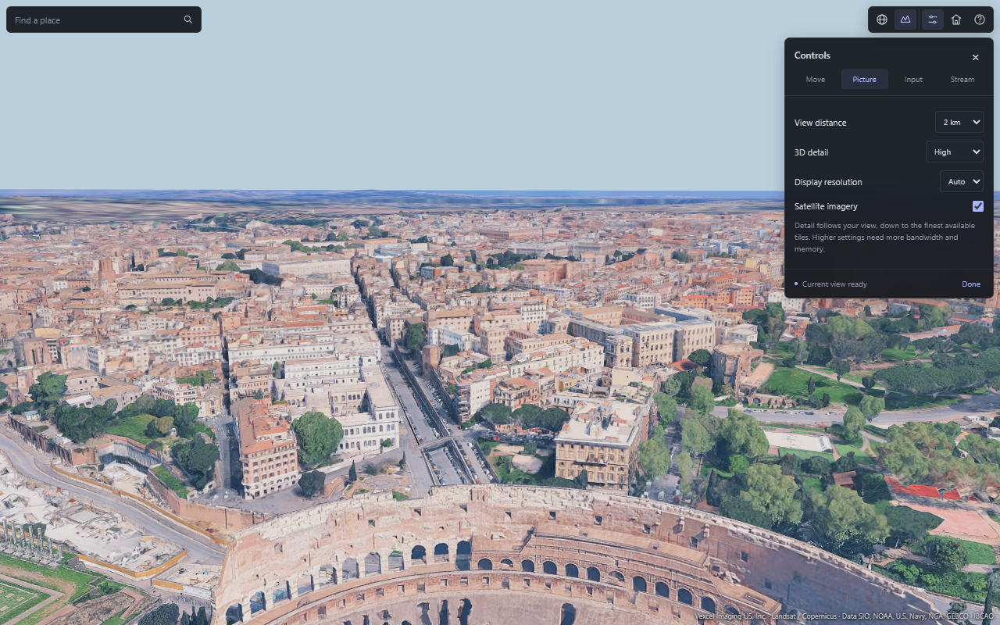

# Tiles 3D High Res

A JavaScript streaming engine and browser viewer for satellite imagery and detailed photogrammetric terrain. One bundle contains both the 2D satellite layer and the 3D tile engine, using the same provider. The viewer opens as a globe; selecting **Fly 3D** starts flight above the selected location and loads nearby geometry automatically.

There is no download button. Images refine as you zoom, and 3D terrain streams as you fly. The default 3D viewing distance is **2 km**.

## Preview

### Satellite globe


### Detailed satellite view


### Flight and progressive 3D streaming


### Control centre



These are screenshots of the actual viewer. The flight image shows a completed camera-selected view with mixed detail levels; it does not imply terminal resolution across the entire 2 km disk. Imagery and geometry retain their providers' copyrights. The viewer interface is in English.

## Build and run

Use Node.js **24.22.1** (`.nvmrc`) and npm **11.10.1** (`packageManager`). No API key is included or required by the currently configured endpoints.

```sh
git clone https://github.com/Artur73737/tiles-3D-high-res.git
cd tiles-3D-high-res
npm ci
npm run build
```

Open the generated `globo-hq.html` in a current desktop Chrome browser. The page contains its JavaScript and styles, so a separate application server is unnecessary. An internet connection is required for map data. For embedding or consistent persistent-cache behavior, serve the files from a stable localhost or HTTPS origin.

The build creates:

| Artifact | Purpose |
| --- | --- |
| `globo-hq.html` | Self-contained viewer with globe navigation, flight, walking, collision detection and UI |
| `dist/earth-hq.bundle.js` | One IIFE script exposing `window.EarthHQ`, including Three.js, the satellite layer and the 3D decoder/streamer |
| `dist/earth-hq.esm.js` | One ES module containing both layers; imports `three` from the host application |

Generated artifacts, dependencies, local caches and downloaded fixtures are excluded from Git. Rebuild after changing source files. `examples/integration.html` demonstrates the single-script integration after building.

## Using the viewer

The globe uses satellite tiles. Drag to rotate with direct 1:1 surface tracking: the grabbed point stays under the pointer, with no acceleration or inertia after release. Use the wheel or the plus/minus buttons to zoom, or search for a location, city, country or street. Press Enter or the search icon, then select a result to centre the satellite globe. Country and city results use a wider view than street addresses. **Fly 3D** enters flight over the point at the centre of the globe view. Double-clicking a point on the globe enters 3D there. The home button returns to the Rome demonstration in 3D.

In 3D, click the scene to capture the mouse. Escape releases it. A 34 px floating toolbar holds globe/flight modes, Controls, Rome and Help. A small place-search field occupies the opposite corner. There is no permanent sidebar or status banner. Controls opens a 268 px popover with Move, Picture, Input and Stream tabs; altitude, progress and diagnostics live in Stream. With Controls closed, the tested interface occupies 1.3% of a 1440x900 viewport and 4.6% of a 390x844 viewport. Flight currently requires a keyboard and mouse; touch movement controls are not implemented.

The **Controls** panel changes the live viewer:

| Control | Available settings |
| --- | --- |
| Navigation | Fly/walk, return to the starting point, visit Rome |
| Speed and camera | 1–16x flight speed; 35–100 degree field of view |
| Picture | 500 m–10 km viewing presets; Ultra, High or Balanced detail; Auto/1x/1.5x/2x display resolution; satellite visibility |
| Input | Look sensitivity, invert vertical look, crosshair, keyboard guide |
| Streaming | 1/2/4/8 GB tile memory budget, pause/resume, retry failed tiles |
| Reset | Restore the default viewing and input settings |

Settings last for the current page session. High is the default detail scale (1); Ultra uses 0.5 and Balanced uses 2. All presets can reach actual terminal nodes as the camera approaches the surface. The memory budget is an admission limit; lowering it does not immediately discard required resident geometry.

| Input | Action |
| --- | --- |
| Mouse | Look around while the pointer is captured |
| W / A / S / D | Move forward / left / backward / right |
| Double-tap W, holding the second press | Move three times faster until W is released |
| Wheel forward / backward in flight | Increase / decrease flight speed, from the default 1x up to 16x |
| Click the speed indicator | Reset flight speed to 1x |
| Space in flight | Ascend |
| Shift in flight | Descend |
| Double-tap Space | Toggle flight and walking |
| Space while walking | Jump |
| G | Return to the satellite globe |
| R | Return to the starting point (flight or prepared ground) |
| Escape | Release the pointer |

Flight starts at 8 m/s horizontally. Each wheel step changes the speed multiplier by 25%; scrolling backward stops at the default. The multiplier also applies to ascent/descent and combines with sprint. Collision steps scale with travel distance at higher speeds. In globe mode the wheel still zooms.

Place search uses the [Photon public geocoder](https://github.com/komoot/photon/blob/master/docs/api-v1.md), with OpenStreetMap data. Queries are sent only on submission, not on every keystroke. Search requests time out after 12 seconds; replacing the query or dismissing results cancels the old request. The geocoder is separate from tile delivery: both imagery layers still use the same tile provider. The public search service has no availability guarantee.

Flight entry resolves a conservative local elevation bound from metadata, then starts 80 m above that bound. It does not wait for a disk of terminal geometry. Flight remains responsive while geometry streams and collides with available meshes. Selecting Walk explicitly prepares a 12 m terminal ground region and finds a walkable surface; walking then keeps local terminal collision data available. Gaps and inaccuracies in the provider's geometry can affect collisions.

Optional URL parameters:

```text
globo-hq.html?view=3d                     Start directly in flight
globo-hq.html?view=3d&visibility=3000     Request a 3 km 3D viewing distance
globo-hq.html?view=3d&visibility=300      Use a smaller area for constrained hardware
globo-hq.html?view=3d&hqAltitude=1800    Activate automatic HQ streaming below 1.8 km
```

`radius` is also accepted as a compatibility alias for `visibility`. The default is 2,000 m. Higher distances increase network, CPU and GPU requirements substantially.

## How the bundle works

### Satellite imagery

`SatelliteLayer` selects Web Mercator raster tiles for the visible part of the globe. It requests more detailed tiles as their projected texels become larger than the screen target. Parent tiles remain visible while children load or when detailed imagery is unavailable. The selection uses the drawing-buffer resolution, not a single stretched overview texture.

The default maximum request zoom is **22**, configurable through `maxZoom`. The layer requests the detail needed at the current view scale, up to that ceiling. Native image resolution varies by location; requesting a higher zoom cannot create detail absent from the source. Satellite coverage ends at approximately +/-85.05 degrees latitude, the Web Mercator limit; polar caps use the base sphere color.

Requests, decoded image ownership, view selection and LRU eviction are managed by the satellite layer inside the bundle. The demo HTML does not implement a second map provider. The layer retains up to 512 raster tiles by default and uses eight concurrent requests, mipmaps and anisotropic filtering. A parent stops drawing after all selected child patches are resident; it is restored if a required child disappears.

### Maximum-detail 3D terrain

`EarthHQStreaming` has two demand policies. The viewer uses camera-driven progressive selection (`screenSpaceError: 1`). Explicit `requestRegion()` calls without a camera still enumerate every selected terminal node, useful when complete terminal coverage of a small area is required. Neither policy imposes a hard-coded depth ceiling. Terrain, buildings and decoded additional surface layers are retained.

The camera policy follows the shipping reference client's reconstructed projection, admission and request-order rules. It uses oriented metadata boxes and the horizontal pixel scale:

```text
angularFactor = max(1e-9, 1-weight + weight * max(0, -dot(outward, ray))^0.2)
projectedTexel = metersPerTexel * horizontalPixelScale / closestBoxForwardDepth * angularFactor
score = log2(0.8) + log2(projectedTexel / screenSpaceError)
cold refinement: score > -0.2
payload admission: score >= -1
```

The thresholds, projection operations, parent-mesh staging, request comparator, texture request families and 12-worker ceiling were checked against downloaded assets and the running reference renderer. The evidence, artifact hashes, offsets and remaining differences are documented in [Reference client analysis](docs/reference-client-analysis.md). The angular weight is derived from decoded mesh geographic bounds, with a coalesced selection pass after geometry arrives. The bundle now uses paired parent/child transitions, GPU octant masks, the recovered four-sample sharp texture filter and premultiplied transition output. The transition metric is compared directly with unchanged original WASM function bodies; 1,863 numerical steps match exactly. See [transition reconstruction](docs/transition-analysis.md) and [request cancellation](docs/request-cancellation-analysis.md) for the source boundaries and verification. These tests establish the documented terrain paths, not binary identity with the entire reference application.

A visited metadata node does not automatically become a payload request. Nodes below the admission threshold leave their footprint to an admitted ancestor. Continuing into metadata uses the separate upper threshold; the former permanent `refinedPaths` hysteresis has been removed because the reference's recent-frame exception belongs to active fades, not to metadata visits.

In the observed 3D traversal profile, a node can request its own payload while its parent loads, but expanding that node waits for the parent's resident mesh. This allows two generations to overlap without crawling every descendant before ancestor data arrives. The demo uses this staged profile throughout its Rocktree traversal. There is no separate preview queue or full-radius preflight scheduler.

Requests use the recovered lexicographic comparator: traversal mode, request priority, resource flag, decreasing projection score, then payload before metadata for exact ties. The old gaze buckets and fixed payload/metadata burst ratio have been removed. Every node uses its own provider epoch. Imagery-epoch nodes request `!2e1!3u...`; photogrammetric nodes request `!2e6`, matching the observed request families. Browser decoding runs in an embedded pool of up to `min(hardwareConcurrency, 12)` workers. The worker code stays inside the same JS bundle and self-contained HTML.

Terrain shading uses the recovered atmospheric lookup tables and equations: sun/sky illumination, aerial perspective, night tint, exposure and automatic atmosphere fading. The sun follows the original default camera-relative rule; the fade follows camera tilt, field of view and height above available ground, with the original zero-elevation fallback when no ground is loaded. The demo samples its loaded collision surface for that height. The 64×128 floating-point inscatter table is shared per renderer, recomputed only when its inputs change and released with its final material owner. The six original GPU reference cases match with zero maximum table error. See [atmosphere CPU analysis](docs/atmosphere-cpu-analysis.md) for the recovered defaults and [reference analysis](docs/reference-client-analysis.md) for shader provenance and sampled render state. Terrain textures use the observed linear sampling and anisotropy up to 8, limited by the device.

Each arriving child replaces its own octant of its parent mesh through a paired transition. An opaque primary pass keeps coverage while the secondary pass blends; the primary changes at the midpoint. The source metric uses a one-second nominal duration, score-dependent timing, smoothstep and a 1/64 coefficient offset. Fast projected motion selects the current mesh immediately. Vertex masks keep the decoded index buffers immutable, and transition passes share their geometry and textures. Other octants remain visible until their children are available. Unknown metadata cannot hide a fallback. Turning preserves resident geometry inside the retention radius, and evicting a child restores the parent portion. Local collision meshes use the selected octant inventory and are rebuilt when it changes, so a replaced coarse surface cannot remain as an invisible collision wall. Nonempty source layer four disables pairing, matching the decoded original mesh flag. A resident tile re-entering the view is selected immediately; see [transition eligibility](docs/transition-eligibility-analysis.md).

Approaching the surface increases the projection score and continues traversal to the provider's terminal nodes wherever the visible detail requires it. A terminal ground disk is requested only while walking. Flight selection follows the camera. Off-screen missing demand does not establish collision coverage, and flight is no longer stalled by that missing inventory.

Movement and camera changes update selection, including vertical movement, pitch and viewport changes. In-flight payload priority follows the latest camera. Untouched payloads are canceled after the recovered two-frame grace period; queued obsolete requests are removed, active fetches and retry waits are aborted, and valid completed cache writes retain ownership. Shared metadata/byte requests survive while another caller still needs them. A superseded discovery releases its own subscriptions; late canceled decodes cannot replace current metadata. Short bursts of movement coalesce while useful metadata work finishes; a large direction change can replace demand immediately. Root metadata is refreshed periodically rather than fetched afresh on every small camera movement. Tile metadata and bytes retain HTTP freshness semantics.

Automatic 3D requests start below **2,500 m**, pause above **3,000 m**, and resume on descent. Globe mode explicitly pauses 3D; **Fly 3D** enters flight. The satellite layer continues independently. The old `previewRadiusMeters` option, separate preview collections and preview counters have been removed. Use camera selection for progressive fallback rendering; explicit region requests still provide terminal coverage through the single asset queue.

### Coverage is explicit

`getCoverage().detailMode` distinguishes `screen-space` and `terminal`. In camera mode, `complete` means all selected nodes needed for that view are loaded, including mixed depths. In terminal mode it means every selected terminal leaf is loaded. Moving or zooming can demand finer nodes again. An idle queue or a visible fallback does not establish complete coverage.

`transitioning` counts active parent/child pairs; `complete` describes data readiness and does not wait for their visual fade to end. `requiredLeaves` and `readyLeaves` retain their API names; in camera mode they count selected nodes, including nonterminal ones. `fallbackFailures` reports failed ancestor previews separately from missing selected nodes. A fallback failure does not poison a view whose selected descendants are ready. Unknown metadata, selected-node failures and capacity exhaustion remain incomplete coverage. These flags describe the provider hierarchy, not the absence of source photogrammetry holes.

A two-kilometre area can contain more than 150,000 terminal tiles. The viewer selects detail for the current pixels and reaches terminal depth as needed while retaining a wide view. It does not download every terminal tile in the entire disk as a prerequisite for rendering.

## Single-script integration

Use the exported `THREE` instance with the standalone bundle:

```html
<script src="dist/earth-hq.bundle.js"></script>
<script>
const { THREE, EarthHQStreaming, SatelliteLayer, geoToECEF } = EarthHQ;
const renderer = new THREE.WebGLRenderer({
  antialias: true,
  logarithmicDepthBuffer: true
});
renderer.setSize(innerWidth, innerHeight);
document.body.appendChild(renderer.domElement);

const scene = new THREE.Scene();
const camera = new THREE.PerspectiveCamera(55, innerWidth / innerHeight, 0.1, 1e8);
const focus = geoToECEF(41.88931, 12.49223);
camera.position.copy(geoToECEF(41.88931, 12.49223,150));
camera.up.set(0,0,1);
camera.lookAt(focus);

const satellite = new SatelliteLayer({ renderer });
const terrain = new EarthHQStreaming({
  renderer,
  radiusMeters: 100,
  retainRadiusMeters: 200,
  screenSpaceError: 1
});
scene.add(satellite.group, terrain.group);

terrain.start().then(() => {
  renderer.setAnimationLoop(() => {
    satellite.update(camera);
    terrain.update(camera, { focusECEF: focus });
    renderer.render(scene, camera);
    // Display terrain.getAttribution() in your UI.
  });
}).catch(console.error);

// On teardown, stop the render loop, then await both layer disposals.
// The layers do not dispose the host renderer, camera or scene.
</script>
```

For an application that already uses Three.js:

```js
import * as THREE from 'three';
import { EarthHQStreaming, SatelliteLayer } from './dist/earth-hq.esm.js';
```

Resolve `three` to the same instance as the host renderer. Version 0.180.0 is pinned and tested. The library exports the streaming layers, coordinate helpers, byte transport, caches, `RocktreeSource` and `TileError`. Navigation, player physics and the viewer UI belong to the demo, not to the engine bundle.

### Coordinates

Geometry uses ECEF coordinates in metres, with Z pointing north and longitude zero on positive X. The planet radius comes from `PlanetoidMetadata`; the captured radius is 6,371,010 m. `geoToECEF`, `ecefToGeo` and `localFrame` are exported; `localFrame` provides an East-Up-South local frame.

The satellite sphere is slightly inset at 6,370,890 m to avoid intersection with surface meshes. Its camera and group use the untransformed ECEF world frame. The 3D engine can convert the camera into its group space; explicit `focusECEF` and headings must be in that same ECEF frame. Keep both layers in the common frame when using them together.

### 3D API

```js
await terrain.start();
terrain.update(camera, {
  focusECEF: playerPositionECEF,
  radiusMeters: 2000,
  viewDirectionECEF: horizontalHeading,
  viewHalfAngle: Math.PI / 3,
  nearRadiusMeters: 60
});

// Optional explicit region request; bypasses the automatic altitude gate.
const coverage = await terrain.requestRegion({
  latitude: 41.88931,
  longitude: 12.49223,
  radiusMeters: 100
});

terrain.addEventListener('progress', ({ coverage }) => updateStatus(coverage));
terrain.addEventListener('error', ({ error, phase }) => showError(error, phase));
terrain.addEventListener('warning', ({ error }) => showWarning(error));
terrain.addEventListener('tile-load', ({ asset }) => onTileLoaded(asset));
terrain.addEventListener('tile-unload', ({ asset }) => onTileUnloaded(asset));
terrain.setEnabled(false);
terrain.setEnabled(true);
await terrain.retryFailed();
terrain.setGpuBudget(768 * 1024 ** 2);
await terrain.waitForIdle();
await terrain.dispose();
```

Without a heading, a region request covers a full disk. `requestRegion({..., waitForCompletion:false})` starts discovery without waiting for completion. `waitForIdle(timeoutMs)` defaults to 120 seconds; the automatic update loop does not impose that timeout on distant background loading.

Coverage includes `status`, `complete`, `cameraAltitudeMeters`, `requiredLeaves`, `readyLeaves`, `missingLeaves`, `unknownBranches`, `failedLeaves`, `gpuBytes`, `errors`, and network/cache counters. Use `getAttribution()` for runtime map credits. Camera selection is enabled with the constructor option `screenSpaceError: 1`; explicit region calls without `cameraView` continue to request terminal coverage.

### Access decoded 3D meshes

A `tile-load` event exposes `asset.meshes`, the decoded Three.js meshes, and `asset.group`, their georeferenced transform. `asset.descriptor.leaf` identifies an actual provider terminal; there is no synthetic depth cap. `asset.mask` identifies selected octants. The base mesh list excludes temporary transition passes, which share the same buffers. The streamer owns these resources: copy data you need to keep after tile eviction or engine disposal.

```js
terrain.addEventListener('tile-load', ({ asset }) => {
  for (const mesh of asset.meshes) {
    consumeMesh(mesh.geometry, asset.group.matrix, asset.descriptor);
  }
});
```

### Satellite API

```js
const satellite = new SatelliteLayer({
  renderer,
  radius: 6370890,
  maxZoom: 22,
  maxTiles: 512,
  concurrency: 8
});
satellite.update(camera);
const status = satellite.status();
await satellite.dispose();
```

`status()` exposes target/ready zoom, visible/resident tiles, pending/queued requests, request count and the latest error. A ready zoom is the highest loaded visible tile level, not proof that every visible tile has reached that level. Both layers accept a custom `fetch` implementation.

## Resource limits and cache

| Setting | Engine default | Viewer |
| --- | --- | --- |
| 3D active radius | 70 m | 2,000 m |
| 3D retention radius | 150 m | 1.15 times viewing distance |
| 3D network concurrency | 18 | 18 |
| Byte cache in RAM | 32 MiB | 32 MiB |
| IndexedDB byte budget | 512 MiB | 1 GiB |
| Estimated 3D GPU budget | 512 MiB | 4 GiB |
| Maximum individual 3D response | 64 MiB | 64 MiB |
| Camera screen-space error scale | Disabled (`0`) | `1`, with separate admission and continuation thresholds |
| Decoder workers | Main-thread source fallback in Node | Up to 12 embedded workers |
| Satellite requests / retained images | 8 / 512 | 8 / 512 |

The GPU budget estimates geometry and texture storage, excluding some driver overhead and the separate satellite layer. A 4 GiB budget is substantial; lower it for constrained devices. Capacity exhaustion stops unusable new downloads and reports incomplete coverage. Move to a smaller area or increase the budget to resume.

The 3D byte cache respects HTTP freshness and uses LRU eviction. IndexedDB failure falls back to RAM and is reported in coverage. Browser origin, profile, storage quotas, clearing site data and expired entries affect reuse. Satellite textures use their own in-memory LRU plus normal browser HTTP caching. Neither layer builds a complete offline copy of the planet.

## Network recovery

3D requests retry transient connection failures, interrupted response bodies, HTTP 408/429 and server errors automatically, with at most three attempts and a 15-second timeout per attempt. Retries remain inside the existing concurrency limit. Missing resources, access-denied responses and byte-budget failures are not retried. Server-directed retry delays are respected; delays longer than the request timeout remain explicit failures.

A failed entry into 3D returns to the usable globe instead of leaving the viewer stuck in loading. After connectivity returns, select **Fly 3D** again; a failed startup no longer poisons later attempts. Permanent network or browser access restrictions cannot be repaired by retries, and are reported without claiming complete coverage.

## Validation

Download the small captured protocol fixtures before running source tests:

```sh
npm run fixtures
npm test
npm run build
npm run test:browser
npm run test:demo
npm run test:viewer
npm run test:controls
npm run test:rotation
npm run test:automatic
npm run test:altitude
npm run test:network
node test/terrain-rendering.mjs
node test/atmosphere-rendering.mjs
# Optional comparison with the explicitly supplied matching reference capture:
node test/reference-fade.mjs /path/to/earthplugin_web.wasm
```

`npm run fixtures` verifies the byte length and SHA-256 from `test/fixtures/manifest.json`, reuses matching local captures and refuses to overwrite mismatching files. If the provider changes or removes a pinned response, acquisition fails explicitly; it does not silently replace a golden fixture. The binary responses are not committed.

Browser tests use an installed Chrome. Set `BROWSER_EXECUTABLE` to override the Windows default, for example:

```powershell
$env:BROWSER_EXECUTABLE = 'C:/Program Files/Google/Chrome/Application/chrome.exe'
npm run test:viewer
```

Source tests cover real captured decoding, terminal traversal, unknown metadata, cache freshness, cancellation, late completion, resource disposal, capacity recovery, altitude gating, gaze and pitch prioritization, staged parent dependencies, reference request ordering, wheel speed limits, geocoder response validation, local collision inventory, partial octant replacement, rotation retention and satellite patch geometry. Browser tests require live network access and write ignored reports/screenshots into `test-results/`.

The network test injects startup, metadata and tile-request failures in Chrome and checks automatic recovery, bounded failure, and a successful second entry into flight. The viewer test checks satellite detail growth, independent layer demand, flight entry and responsive UI. The controls test checks place search, wheel speed, keyboard selection, tabbed settings, dark-theme layout, screen occupancy, walking preparation and camera-view completion in Chrome. The rotation test checks object identity/retention after turning away and back. The automatic/view test checks mixed-depth two-kilometre demand, workers, camera turns, resident retention and deeper terminal selection on descent. The altitude test checks pause/resume while flying and explicit pause in globe mode. Some headless tests cap rendering at approximately 10 fps to control software-rendering cost; the actual viewer has no such cap.

On 2026-11-03, the automatic browser check entered flight in **0.87 s** and completed the initial 1280x800 Rome view in **25.24 s** from navigation. It selected 171 nodes at depths 16–20 and retained all 316 resident tiles through a turn. Descending selected 296 nodes, including 123 actual terminals, at depths 15–22. Synthetic hierarchy tests additionally reach terminal depth 30, establishing that there is no 22/25-level cap. These are camera-dependent mixed-depth views, not terminal coverage of the entire disk. The controls check covers four viewport sizes, search, settings, wheel speed and walking preparation.

A completed-task comparison against commit `806d521` used a 960×600 viewport, 2 km viewing distance, detail scale 1 and the same camera at 110 m altitude. Both versions selected the same 113 nodes (verified by demand-key digest). The current bundle includes the new terrain shader and transitions; the previous version did not. Each pair used a fresh browser profile for the cold run and reused its persistent cache for the warm run. Rendering was capped at 10 fps for this headless measurement. “Data ready” waits for the selected inventory; “Settled” additionally waits for visual transitions to end.

| Cache | Version | Flight entry | Data ready | Settled | Requests | CPU seconds | Peak sampled family working set | Peak sampled private bytes |
| --- | --- | --- | --- | --- | --- | --- | --- | --- |
| Cold | Before | 1.39 s | 36.00 s | 36.00 s | 270 | 13.32 | 1061 MiB | 1179 MiB |
| Cold | After | 0.96 s | 45.61 s | 46.68 s | 272 | 14.83 | 1104 MiB | 1221 MiB |
| Warm | Before | 0.20 s | 1.39 s | 1.39 s | 2 | 6.80 | 1218 MiB | 1422 MiB |
| Warm | After | 0.19 s | 1.01 s | 2.05 s | 3 | 7.93 | 1376 MiB | 1582 MiB |

Cold transferred bytes were 20.77 MB in both versions. The current cold run had two 15-second response timeouts, followed by successful automatic retries; the previous cold run's slowest request took 10.62 seconds. The measured median request durations were 1.51 seconds after and 1.69 seconds before. These network timings explain a concrete source of delay, not every difference in elapsed time. A preceding matched run measured 23.92 seconds before and 45.05 seconds after for data readiness. The new shader and paired rendering also add CPU and geometry storage. This change does **not** establish a cold-load speedup. Warm data readiness improved in this sample, while the original-style fade deliberately adds approximately one second before visual settlement.

The browser tests passed with 76 source tests, the four network-recovery scenarios, automatic flight/turn/descent/retention, controls at four viewport sizes, GPU octant/blending checks, six atmospheric GPU reference cases and 1,863 direct fade-metric comparisons. The network-recovery run preceded the final atmosphere changes; the final shader and control checks ran afterward. An initial concurrent browser run timed out; isolated profiling and the completed automatic run passed. The profiling sample used 1.24 renderer task CPU seconds over 12.69 elapsed seconds while requests continued to complete.

CPU includes the dedicated Chrome process family. Memory samples can miss short-lived peaks, working sets can double-count shared pages, and harness/PowerShell overhead is excluded. Agent token usage was not measured. Live network and GPU results vary; no universal loading-time guarantee is implied. Reports retain artifact SHA-256s, selected-key digests, network timing summaries and the slowest request URLs.

Reproduce a completed-view comparison after building each version, using a distinct label for each:

```sh
node test/performance.mjs view-current globo-hq.html 2000 0 110
```

Ignored JSON reports and screenshots live under `test-results/`. Passing `15` instead of `0` selects a fixed 15-second observation without waiting for completion. `test/performance.mjs` also supports a completed 50 m terminal-region benchmark when the view arguments are omitted. `test/profile.mjs` is a bounded local profiling helper.

## Source layout

```text
src/index.js              Public bundle exports
src/satellite.js          Raster selection, requests, meshes and image lifetime
src/streamer.js           Unified 3D traversal, admission, capacity and asset lifetime
src/source.js             Rocktree metadata traversal and payload loading
src/transport.js          Deduplicated, prioritized, cancellable byte requests
src/demand.js             Shared request subscriptions and cancellation ownership
src/transitions.js        Source-matched fade metric and paired selection
src/terrain-material.js   GPU octant masks, sharp texture filter and unpop passes
src/terrain-atmosphere.js Original terrain atmosphere equations and shared GPU tables
src/cache.js              RAM and IndexedDB caches
src/protobuf.js           Metadata parsing
src/geometry.js           Octant masks, asset construction and disposal
src/decoder.js            Embedded browser worker pool and lifetime
src/geo.js                ECEF and region geometry
src/vendor/               Retained client-derived payload decoder
src/demo/                 Viewer UI, navigation, flight and collisions
examples/                 Single-bundle integration example
test/                     Source and live-browser checks
scripts/                  Verified fixture acquisition
docs/previews/            Viewer screenshots used above
licenses/                 Third-party dependency notices
```

## Provider, attribution and provenance

Both layers use Google-operated services: Rocktree at `https://kh.google.com/rt/earth/` for 3D and the satellite raster endpoint at `https://mt1.google.com/vt` for 2D. These endpoints are undocumented and differ from the official Map Tiles API; availability, coverage, CORS behavior and protocol compatibility may change. This project is independent and is not an official provider SDK.

The viewer displays the 3D copyright credits returned by the service. Data, imagery and the retained client-derived decoder are not granted a new license by this repository. Dependency MIT notices apply to their respective libraries, not to all bundled content. See [SOURCE-NOTICES.txt](SOURCE-NOTICES.txt) and [licenses](licenses) for provenance and notices.
