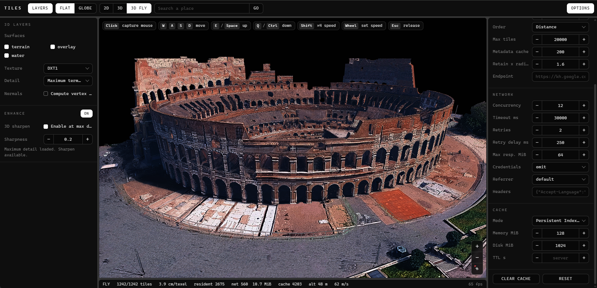

# Tiles

Google satellite imagery (2D) and Google photorealistic 3D at full resolution, in one standalone
script: `dist/3d_tiles.bundle.min.js`. Three.js is bundled. The script exposes the global `Tiles`.

Two ways to use it, sharing the same API:

- **API only.** `Tiles.Tiles2D` and `Tiles.Tiles3D` fetch tiles and decode them for you.
- **Viewer.** `Tiles.createViewer(target, options)` mounts an iframe with the full UI on top of the same API.

| 3D fly | 2D satellite | Globe |
|---|---|---|
|  |  |  |

## Build

```bash
npm ci
npm run build      # dist/3d_tiles.bundle.min.js + standalone.html
npm test
```

`standalone.html` is a ready-to-open demo: the bundle plus a single `createViewer` call.
It is published on GitHub Pages at <https://artur73737.github.io/tiles-3D-high-res/> on every push to `main`.
It accepts `?view=flat|globe&mode=2d|3d|fly&lat=..&lon=..&zoom=..`.

## Load

```html
<script src="3d_tiles.bundle.min.js"></script>
<script>
  console.log(Tiles.VERSION);
</script>
```

## Viewer (iframe UI)

```html
<div id="map" style="width:100%;height:600px"></div>
<script src="3d_tiles.bundle.min.js"></script>
<script>
  const viewer = Tiles.createViewer('#map', {
    view: 'flat',            // 'flat' | 'globe'
    mode: '3d',              // '2d' | '3d' | 'fly'
    latitude: 41.89021,
    longitude: 12.49223,
    zoom: 18,
    panel: true,             // right sidebar (options)
    layersPanel: true,       // left sidebar (layers + enhance)
    d2: { layers: ['s', 'h'], scale: 2, language: 'en' },
    d3: { radiusMeters: 500, fullDetailMeters: 150, keepTiles: null }, // keepTiles: null = by device
    network: { concurrency: 12, retries: 2 },
    cache: { mode: 'persistent', diskMb: 1024 },
  });

  viewer.goTo({ latitude: 48.8584, longitude: 2.2945, zoom: 17 });
  viewer.setView('globe');
  viewer.setMode('fly');
  viewer.set({ d2: { layers: ['y'] } });          // changes apply live
  viewer.on('place', p => console.log(p.name));   // also: move, mode, view, tile, error, status
  // viewer.destroy();
</script>
```

Loaded 3D tiles stay when the camera moves or turns. A tile is removed only in two cases:

- It is replaced by tiles covering the same ground. Detail never goes down, and a coarse tile stays
  until all of its finer tiles are ready.
- More than `keepTiles` tiles are loaded. The default is 8000 on desktop, 4000 on tablet and 2500 on
  phone, about 93 KB of GPU memory each. The farthest tiles go first.

### Phones and tablets

The viewer detects the device (`desktop`, `tablet` or `mobile`) and adapts:

- The sidebars become drawers over the map.
- The navbar is compact, and touch targets are larger.
- Touch gestures:
  - 2D: drag to pan, pinch to zoom.
  - 3D: drag to orbit, two fingers to pan.
  - Globe: drag to pan, pinch to zoom, twist to rotate, two-finger drag to tilt.
- Fly mode has an on-screen stick, up / down buttons, and drag to look around.

Desktop is unchanged. To force a device class, pass `createViewer(target, { device: 'mobile' })` or
call `viewer.setDevice('tablet')`. `viewer.getDevice()` returns the current class, and the `device`
event fires when it changes.

Other controller methods: `zoomIn()`, `zoomOut()`, `resetNorth()`, `searchPlaces(text)`,
`setGeocoder({...})`, `setEnhance({...})`, `exportPNG()`, `getView()`, `getStats()`, `getFps()`.

## API only

### 2D imagery

```js
const t2 = new Tiles.Tiles2D({ layers: ['s'], scale: 2, language: 'en' });

const tile = await t2.getTile(18, 140111, 97411);          // { bytes, mimeType, ... }
const url  = t2.tileUrl(18, 140111, 97411);
const max  = await t2.findMaxZoom(41.89021, 12.49223);      // deepest real imagery

const img = await t2.getImage(
  { west: 12.490, north: 41.892, east: 12.494, south: 41.888 }, 18);
document.body.append(img.canvas);                           // or await img.blob()
```

Layers: `s` satellite, `y` hybrid, `h` labels, `m` roadmap, `p` terrain+, `t` relief,
`r` roads, `traffic`, `transit`, `bike`. Styles go through `setStyle('s.t:3|p.v:off')`.

### 3D meshes

```js
const t3 = new Tiles.Tiles3D({ radiusMeters: 150, coordinates: 'local' });
t3.setLocation(41.89021, 12.49223);

const list = await t3.listTiles();                 // descriptors, no payload yet
const tile = await t3.getTile(list.tiles[0]);      // positions, uvs, indices, texture per mesh
const h    = await t3.getElevation(41.89021, 12.49223);

// Three.js scene object (Three.js is in the bundle; any renderer works)
const group = await t3.toThree(tile, { renderer });
scene.add(group);

// Everything in the area, with progress
await t3.getTiles({}, { onProgress: p => console.log(p.done, '/', p.total) });
```

### Place search

```js
const geo = new Tiles.Geocoder();                  // 'auto' | 'photon' | 'nominatim' | 'google' (apiKey)
const [best] = await geo.search('chernobyl');      // { name, context, latitude, longitude, zoom }
```

Every option has a setter and can also be passed to `set({...})`. Examples: `setLayers`, `setScale`,
`setRadius`, `setFullDetailRadius`, `setConcurrency`, `setRetries`, `setCache`.

## React

Load the bundle once (for example in `index.html`), then mount the viewer in an effect:

```jsx
import { useEffect, useRef } from 'react';

export function TilesViewer({ lat, lon, zoom = 18, mode = '3d' }) {
  const host = useRef(null);
  const viewer = useRef(null);

  useEffect(() => {
    viewer.current = window.Tiles.createViewer(host.current, {
      latitude: lat, longitude: lon, zoom, mode,
    });
    return () => viewer.current.destroy();
  }, []);

  useEffect(() => {
    viewer.current?.goTo({ latitude: lat, longitude: lon, zoom });
  }, [lat, lon, zoom]);

  return <div ref={host} style={{ width: '100%', height: 600 }} />;
}
```

API only in React works the same way: create a `Tiles2D` or `Tiles3D` in an effect and call
`dispose()` in the cleanup.

## Source

```
src/tiles.js         bundle entry (global Tiles)
src/core/            errors, geo, net/ (transport, cache, shared requests, priority), rocktree/ (decoder workers)
src/api/             Tiles2D, Tiles3D, Geocoder, enhancer
src/ui/              viewer, template, scene/ (globe, 3D streaming, fade, sharpen)
```
