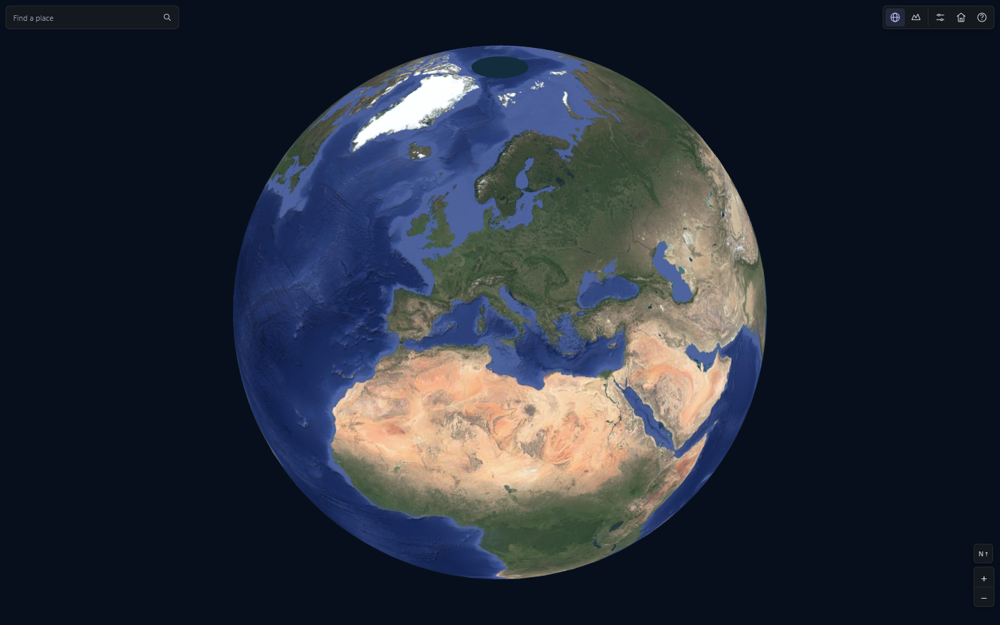
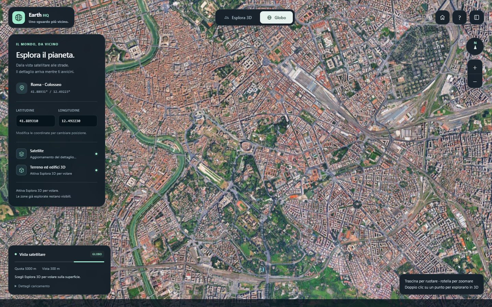
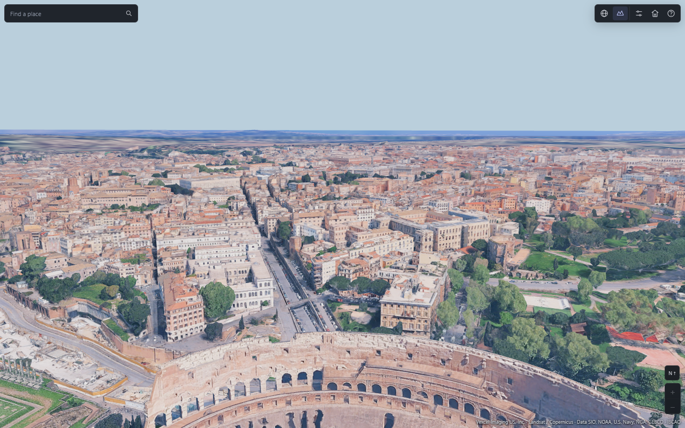
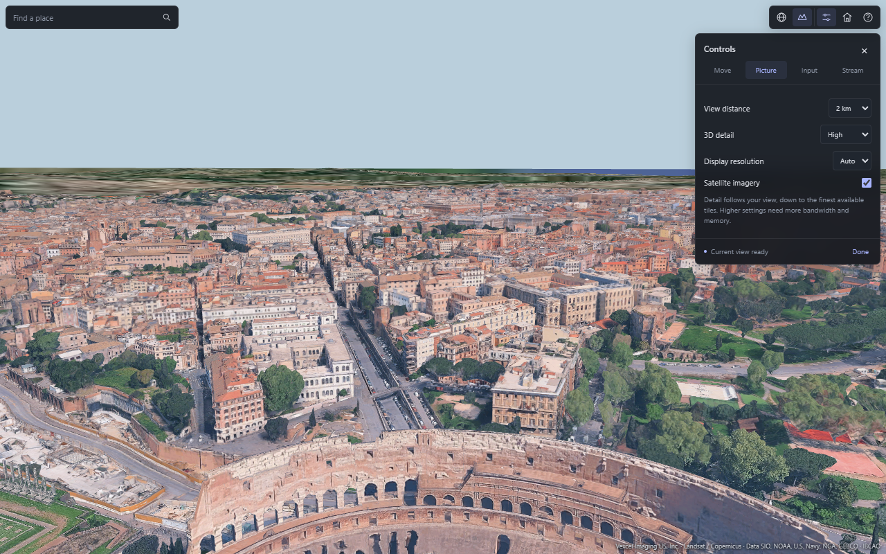

# Optional globe viewer

The compiled API is documented in [README](../README.md). This optional application demonstrates a host renderer using the same 2D and 3D tile engines.

Run `npm run build`, then open the generated `globo-hq.html` in desktop Chrome. Its Three.js renderer and interface are embedded in that HTML and are excluded from `dist/earth-hq.bundle.js`. `npm run build:api` builds only the data API outputs and does not rebuild this application.

Search for a place, zoom the globe or select **Fly 3D**. The English dark interface includes picture, movement, input and streaming controls. The default flight range is 2 km. Wheel forward increases flight speed; wheel backward returns toward the default. The satellite globe uses direct pointer dragging without inertia. Flight downloads data automatically; there is no download button. Walking prepares local collision geometry before placing the player on the loaded surface.

## Previews

These are actual viewer screenshots. Camera-selected views contain mixed detail levels, including parent coverage; they do not imply terminal resolution throughout the full 2 km disk. Provider imagery and geometry retain their copyrights.

The optional renderer owns Three.js meshes, compressed texture uploads, the recovered atmospheric shader, octant vertex masks and primary/secondary blending. The shared data engine supplies geometry arrays and transition plans. See [reference analysis](reference-client-analysis.md) for original-source evidence and verification boundaries.

`npm run test:automatic` exercises flight, camera turns, resident retention, terminal detail on descent and cleanup. `npm run test:controls` checks search, settings, wheel speed, walking preparation and responsive layout. Shader GPU checks are `node test/terrain-rendering.mjs` and `node test/atmosphere-rendering.mjs`.

After extraction, the complete automatic check passed: 171 selected tiles in the initial view, all 316 initial residents retained through a turn, and 123 terminal tiles selected on descent. Source comparisons separately establish matching API/viewer demand and geometry interpretation; this is not a network-speed guarantee.
